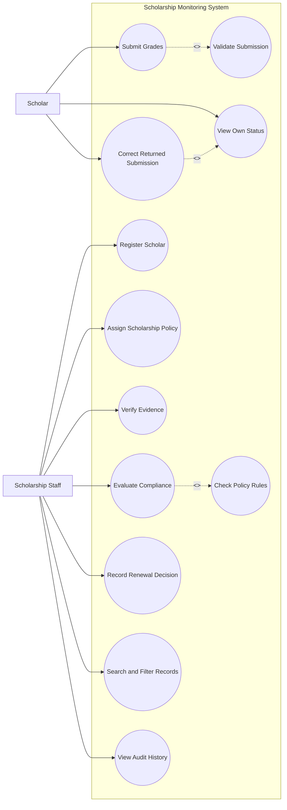
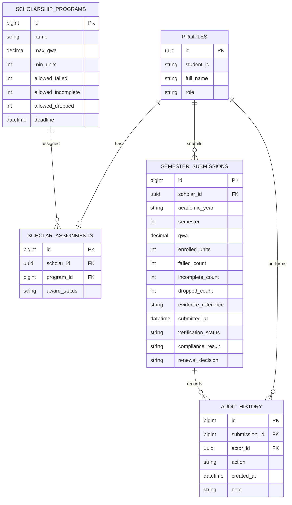

# Part I — Analysis and Design
## A1. Investigation and planning
### Problem statement
The Scholarship Office uses spreadsheets, email attachments, and paper grade records. Duplicate semester entries, unverified grades, missed deadlines, and inconsistent decisions delay scholarship renewal. Scholars cannot reliably determine whether evidence was received, verified, or returned.

### Cause–effect analysis
| Cause | Effect |
|---|---|
| Separate spreadsheets and paper files | Duplicate or missing semester records |
| Evidence checked manually without shared status | Scholars cannot see verification progress |
| Deadlines not consistently monitored | Late submissions may be missed |
| Policy thresholds copied into separate records | Inconsistent renewal recommendations |

### Scope
Included: Scholar and staff roles, program policy records, scholar assignment, semester submission, evidence reference, verification/return, compliance checks, renewal decision, search/filter, audit history, dashboard and testing.
Excluded: Registrar integration, changing official grades, SMS, payments, machine learning, and full appeals/exceptions workflow.

### Development tasks
1. Create relational schema, constraints, and RLS.
2. Implement authenticated scholar submission and duplicate/input validation.
3. Implement staff verification, correction, compliance, and renewal.
4. Run TC01–TC10 and capture evidence.
### Risks and responses
- Incorrect access policies expose records: test with two separate accounts and verify RLS.
- Hosting/network failure: keep a local runnable copy and document run steps.

## A2. Stakeholders and elicitation
| Stakeholder | Role / actor? |
|---|---|
| Scholar | Mandatory system actor; submits and tracks own summary |
| Scholarship staff | Mandatory system actor; verifies, evaluates and decides |
| Registrar | External source of official grades; not a system actor in this MVP |
| Scholarship Office management | Receives summary reports; not a direct actor unless granted an account |

Open-ended interview questions:
1. How do you verify that a grade document reference is acceptable?
2. How are submission deadlines communicated and enforced?
3. What should staff do when evidence is incomplete or unreadable?
4. How should scholars and staff access only the records they are authorized to see?
5. Which counts and filters are needed in a semester report?
6. How should policy changes and exceptional cases be handled outside this MVP?

## A3. Requirements and business rules
### Functional requirements
- FR01: The system shall authenticate users and distinguish Scholar and Staff roles.
- FR02: Staff shall register scholar profiles and assign one persisted scholarship program.
- FR03: Scholars shall submit academic year, semester, GWA, units, failed/incomplete/dropped counts and evidence reference.
- FR04: The system shall reject GWA outside 1.00–5.00 and negative/non-integer counts or units.
- FR05: The system shall reject duplicate scholar + academic year + semester submissions.
- FR06: Staff shall mark evidence Verified or Returned and provide a reason when returning it.
- FR07: A scholar shall correct and resubmit returned evidence, returning it to Pending verification.
- FR08: The system shall evaluate only verified submissions using the selected persisted program policy.
- FR09: Staff shall explicitly approve or hold renewal; approval shall be blocked unless compliance is Compliant.
- FR10: The dashboard shall show counts and support search by ID/name and filtering by program/compliance.

### Non-functional requirements
- NFR01 Security: database policies shall prevent cross-scholar reads and scholar verification/decision changes.
- NFR02 Integrity: database constraints shall prevent duplicate semester submissions and invalid numeric values.
- NFR03 Persistence: saved records and history shall remain after refresh and a new login.
- NFR04 Usability: validation failures shall display a clear message identifying the invalid field or blocked workflow.

### Business rules
- BR01: Merit Scholar maximum GWA 1.75; minimum units 18.
- BR02: Community Scholar maximum GWA 2.25; minimum units 15.
- BR03: Both programs allow zero failed and zero incomplete subjects; Merit allows zero dropped, Community allows one dropped.
- BR04: The deadline is 2026-10-30 17:00 Asia/Manila; exactly at deadline is on time, after is late.
- BR05: Missing/unverified evidence blocks final evaluation. Failed academic conditions or lateness produce With Deficiency; all checks passing produces Compliant.
- BR06: Only staff can make renewal decisions; approval requires Compliant evaluation. Compliance flags do not automatically change award status.

## A4. UML use cases

Relationships: Submit Grades includes Validate Submission because every submission must be validated. Evaluate Compliance includes Check Policy Rules because every evaluation must apply persisted policy thresholds. Correct Returned Submission extends View Own Status because correction is conditional on a returned record being viewed. Authentication is a precondition rather than an include on every use case.

## A5. Detailed use cases
### UC01 — Submit Grades
- Primary actor: Scholar
- Trigger: Scholar chooses Submit Grades.
- Preconditions: User is authenticated, has an active assignment, and is submitting a semester not already recorded.
- Main flow: (1) Select academic year and semester. (2) Enter GWA and counts/units. (3) Enter evidence reference. (4) System validates fields and deadline. (5) System saves a Pending submission with timestamp. (6) System shows confirmation.
- Alternatives: If fields are invalid, show field-level errors; if duplicate semester exists, reject and retain existing record.
- Exceptions: Database/network failure; show failure and do not claim saved.
- Postcondition: One submission exists and is Pending verification.
- Links: FR03–FR05; BR04.

### UC02 — Evaluate Compliance
- Primary actor: Scholarship Staff
- Trigger: Staff selects Evaluate for a submission.
- Preconditions: Staff authenticated; evidence is Verified; policy assignment exists.
- Main flow: (1) Load persisted policy thresholds. (2) Compare GWA, units, failed, incomplete and dropped counts. (3) Check deadline. (4) Record Compliant if every check passes; otherwise With Deficiency and specific reasons. (5) Record evaluator and timestamp in history.
- Alternatives: Any failed condition yields With Deficiency with all failed reasons listed.
- Exceptions: If evidence is not verified, block evaluation; if policy is missing, block and report configuration error.
- Postcondition: Compliance result and evaluation history are saved; award status is unchanged.
- Links: FR08–FR09; BR01–BR06.

### ERD

## A6. Traceability
| FR | Actor | Use case | BR | Screen/function | Test / expected |
|---|---|---|---|---|---|
| FR03 | Scholar | UC01 | BR04 | Submit Grades | TC01: boundary accepted |
| FR05 | Scholar | UC01 | BR05 | unique constraint | TC07: duplicate rejected |
| FR06 | Staff | Verify Evidence | BR05 | Verification | TC09: return and resubmit workflow |
| FR08 | Staff | UC02 | BR01–BR05 | Evaluate Compliance | TC02–TC06: correct results and gate |
| FR09 | Staff | Record Renewal Decision | BR06 | Renewal | TC10: compliant approve; deficient hold |

Planned but not fully implemented in this starter: end-to-end Supabase CRUD wiring for every screen, append-only database audit triggers, fully populated six-user seed script, and executed TC01–TC10 evidence. Mark each as incomplete until implemented and tested.
